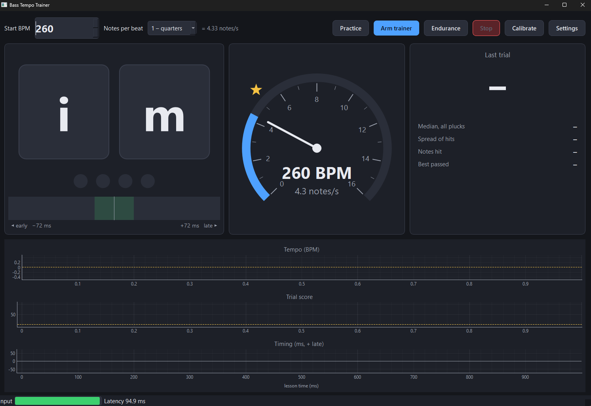

# Bass Tempo Trainer

A Windows practice app for building two-finger (index/middle) plucking speed
on bass. It plays a metronome, listens to your raw bass signal live, scores
how well each note lands on the beat, and in training mode raises the tempo
each time you hold it.



- **Metronome with a visual:** two boxes, **i** and **m**, light in turn on
  every note, with beat dots underneath. Each box flashes green / yellow /
  red with the timing of the pluck you just played.
- **Live timing feedback:** a strip of your last 16 plucks on an early/late
  axis, and a per-note timing graph across the whole lesson.
- **Scored trials:** every few bars get a 0–100 score, plus a plain-language
  verdict: *locked in*, *rushing 12 ms*, *dragging*, *speeding up*,
  *slowing down*, *unsteady*, missed or extra notes.
- **Training mode:** pass a trial and the tempo steps up; fail it a set
  number of times in a row and the lesson ends at your top tempo. A
  speedometer shows the current notes per second, with a gold mark at this
  lesson's best and a gold star at your all-time record, and a graph shows
  the tempo climbing through the lesson.
- **Endurance test:** hold a share of your record for as long as you can,
  scored as time held, with how you tired along the way.

## Requirements

- Windows 10/11, Python 3.12+ (developed on 3.14)
- An audio interface with a WASAPI input for the bass and an output for the
  click. Developed on an Allen & Heath ZEDi-10: the bass goes into **M1**
  (Hi-Z) and the click comes out of **ST2**. Both are found by name, and you
  can change them in **Settings**.
- A clean, unprocessed bass signal. The pluck detector is built for a raw
  pickup signal; drive and compression smear the attacks it looks for.

## Install and run

```bat
python -m venv .venv
.venv\Scripts\python -m pip install -r requirements.txt
.venv\Scripts\python -m bass_tempo_trainer
```

or double-click `Bass Tempo Trainer.bat`. To try it without a bass or a
mixer, a simulated player plays along:

```bat
.venv\Scripts\python -m bass_tempo_trainer --simulate
```

## Using it

1. **Calibrate once per input** (and again if you change interface, driver
   or buffer size), **with a loopback cable**: patch the click output into
   the input you play through and don't play. The app measures the round
   trip (click leaves the computer → comes back in) and takes it off every
   later measurement. Any analog path in between (a pedalboard, a mixer
   send) adds nothing.

   You can calibrate by playing one note on each of 16 clicks instead, but
   it is the fallback: whatever lead or lag you have against the click goes
   into the latency, and the trainer then can't show it. Most players land
   ahead of a slow click without hearing it (one measured player: ~100 ms
   ahead at 60 BPM, ~50 ms at 80). A result shorter than the round trip
   Windows reports for the stream is impossible for hardware, so the app
   refuses it and keeps the previous calibration.
2. Set **Start BPM** and **Notes per beat** (2 = eighths, so 60 BPM is
   2 notes/s).
3. **Practice** keeps one tempo and scores every few bars. **Arm trainer**
   starts the ladder. **Endurance** is a stamina test: one tempo, a share
   of your record (85 % by default, in Settings), scored on evenness, until
   two trials in a row fail. Its score is how long you held it, with how
   you tired: your timing spread, how far m drifts from i, and whether your
   plucks got softer, each from the first quarter of the test to the last.

Settings cover the trial length, step size, pass score, attempts per
tempo, click volume, clicking every note rather than just beats, which
finger starts the bar, and pluck sensitivity.

## How it works

**One clock.** The click output and the bass input run as a single
full-duplex WASAPI stream, so both share one sample counter. Clicks are
placed at exact output frames, plucks are found at input frames, and the
calibrated round trip links the two. Nothing can drift.

**Pluck detection** (`bass_tempo_trainer/onset.py`). A raw bass pickup
signal is a pulse train: every period of the note has a sharp edge, so a
simple "level went up" detector fires on the note itself. A pluck is
instead a broadband burst (to 6 kHz and beyond) that the sustained note
lacks. The detector:

1. computes spectral flux (400 Hz – 10 kHz) over 2048-sample frames,
   longer than one period of a low B, every 1 ms, and picks its peaks
   against a threshold that follows the background and recent pluck
   heights;
2. tells a pluck from the next finger *landing* on the string. A landing
   is a broadband transient too, typically 15–50 ms before its pluck. A
   landing damps the string and a pluck re-excites it, so of two
   candidates that close together, the one where the level rose more is
   kept.

3. **One note per attack.** A low string (the open B, 31 Hz) can still make
   the flux ripple, firing a second onset two to four periods (65–130 ms)
   from a real pluck. Those have no attack in the audio: the level above
   800 Hz barely moves across them (−7 to +10 dB), where a pluck jumps
   13–35 dB. So an onset that close to another is kept only if it has the
   strongest attack of the group or a fresh attack of its own (12 dB or
   more). A lone onset is always kept, and a real double pluck still counts
   as an extra note.

On real two-finger playing from a raw tap, stage 2 took repeated-note
passages from roughly two detections per note to exactly one. On a
four-minute open-B ladder run up to 216 BPM, stage 3 took the false extra
notes from 11 to 1, with every real pluck kept at the same time.

**Scoring** (`scoring.py`). Each slot of the grid is paired with at most
one pluck. A pluck inside the *tight* window (6 % of the note interval,
between 8 and 20 ms) scores 100, falling to 0 at the edge of the *hit*
window (30 % of the interval, between 25 and 60 ms). Misses score 0, and
each extra pluck costs half a note. The verdict reports the median offset
of **every** matched pluck, hit window or not (rushing/dragging past
6–10 ms), so a steady lead that puts most notes just outside the window
still shows its true size; the spread of the hits (unsteady once it exceeds
the tight window); and the drift across the trial (speeding up / slowing
down).

**Evenness only** (Settings, off by default) is for building speed and
stamina rather than placement. Each trial's grid is first moved onto your
own steady lead or lag (the circular mean of every pluck's phase in its
note interval), then scored exactly as above. So every note, an even
interval and no notes in between is a pass however far ahead of or behind
the click you sit, while missed or extra notes, unevenness and drift still
cost points. Live feedback is graded the same way, against the median of
your last eight plucks. The offset is still measured against the click and
shown as "Median, all plucks", so you can see it without being failed for
it.

**Training ladder** (`lessons.py`). After a count-in, trials of N bars.
The tempo can only change once a trial's result is in. At fast tempos the
last notes' plucks are still in flight when the bar ends, so an unscored
"keep going" bar can fall between trials. After a speed-up, one unscored
"settle in" bar comes before the next trial.

## Your data

Settings and lesson history are in `%APPDATA%\BassTempoTrainer\`. Each
lesson is a JSON file (every trial, every pluck time, the bar grid) and,
unless you turn it off, a WAV of the input, which is useful for checking
the detector against your playing. Calibration runs are saved the same way
(`…_calibrate.json`, with what they measured under `calibration`), so a
played calibration can be compared with a lesson; they are not practice
and never go in the practice log.

`practice_log.jsonl` in the same folder is a one-line-per-lesson summary
for other programs (a practice diary, a dashboard) to read. It is
append-only, and on start-up the app adds a line for any lesson file that
lacks one. Each line is a JSON object:

| field | meaning |
|---|---|
| `v` | format version, currently 1 |
| `session` | the lesson's JSON file in `sessions\` |
| `start`, `end` | local time with UTC offset, ISO 8601 |
| `played_s` | seconds of playing: first downbeat to the end of the last bar or the stop |
| `mode` | `train` (the ladder) or `practice` (fixed tempo) |
| `subdiv` | notes per beat |
| `best_bpm` | fastest tempo with a passed trial, or `null` |
| `best_notes_per_s` | the same as notes per second (`best_bpm × subdiv / 60`), or `null` |
| `trials`, `passed` | trials scored, and how many passed |
| `evenness_only` | `true` if the lesson was scored on evenness only, ignoring a steady lead or lag (added 2026-10-23; absent on older lines) |
| `endurance` | endurance lessons only: `held_s` and `held_notes` (the stamina score), `notes_per_s`, `pct_of_record`, `ended` (`failed` or `stopped`), and `fatigue`: `spread_ms_start`/`_end`, `spread_growth_ms_per_min`, `m_minus_i_ms_start`/`_end` (+ = m late), `level_db_start`/`_end`, `level_change_db` (null without saved audio) |

## Development

```bat
.venv\Scripts\python -m pytest
```

The tests drive the whole core (clicks out, synthetic plucks in) with no
audio hardware: detection accuracy at 2–14 notes/s, calibration recovering
a known round trip, bias reporting, and the training ladder.

## Licence

Public domain ([Unlicense](LICENSE)).
